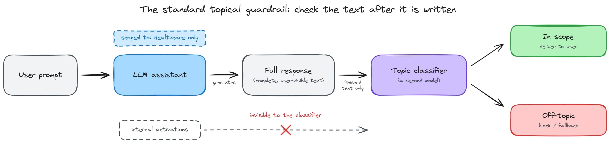
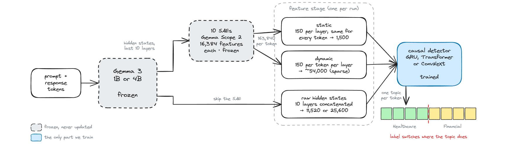

import FigureViews from "../src/components/FigureViews.astro";
import DatasetViewer from "../src/components/DatasetViewer.astro";
import DetectorRunsViewer from "../src/components/DetectorRunsViewer.astro";
import DecodeDemo from "../src/components/DecodeDemo.astro";

We built SAE probes that detect, when an LLM drifts off topic, in real time.

The probes read the model's internal activations and label every token it writes with one of 7 business topics, so the label can change between one sentence and the next. A guardrail built on them can catch an off-topic answer while the model is still writing it, instead of after the user has read it. We trained these small causal probes on Gemma 3 1B and Gemma 3 4B, and in the rest of this log we call them detectors.

Most of our records (4 in 5) cover 2 to 4 topics. They change topic in ordinary prose, with no heading to mark the switch, so a detector scores well only if its labels switch where the response does. We gave the detectors 3 kinds of input. The first 2 come from the Gemma Scope 2 sparse autoencoders (SAEs): a fixed set of features, which we call static, and a set chosen again for each token, which we call dynamic. The third is the raw hidden states with no SAE, our test of whether the SAE is needed at all. The figure below gives the best held-out macro-F1 for each kind of input at both model sizes; its Table tab has the input widths and detector sizes.

<FigureViews label="Figure 1" title="Best test macro-F1 for each detector input, at both model sizes">

| Detector input | Input width | Detector size | Best macro-F1, 1B | Best macro-F1, 4B |
| --- | --- | --- | --- | --- |
| Static SAE, 150 features per layer | 1,500 | 1.4M to 3.6M | 96.2 | 92.4 |
| Static SAE, features chosen with labels | ~1,500 | 1.4M to 3.6M | 96.8 | 96.4 |
| Dynamic SAE, 150 features per token per layer | ~54,000 | 15M to 43M | 97.3 | 97.1 |
| Raw hidden states, no SAE | 11,520 / 25,600 | 4M to 21M | 96.7 | 97.5 |

<figcaption>

Figure 1. Best test macro-F1 for each detector input, at both model sizes.

</figcaption>

</FigureViews>

- **Raw hidden states do as well as SAE features.** Without the SAE, the best detector is within 0.6 points of the best SAE input at 1B (96.7 against 97.3) and ahead of it at 4B (97.5 against 97.1).
- **A fixed SAE feature set chosen without labels breaks down at 4B.** With the 150 most active features per layer, the best detector scores 96.2 at 1B but only 92.4 at 4B. Choosing the same number of features with the topic labels brings it back to 96.4.
- **Detectors trained on synthetic text transfer to the model's own writing.** The detectors learn only from text written by GPT-5.6 Luna. Run on responses Gemma generates itself, with dynamic SAE features, they label 94 to 95 percent of tokens with a topic the prompt asked for, at both model sizes and for all 3 detectors.

The sections below follow the order in which we ran the experiments.

The code is on [GitHub](https://github.com/Mercity-AI/SAE-Guardrails), and the trained detectors are on [Hugging Face](https://huggingface.co/collections/Mercity/online-guardrails-using-sparse-autoencoders-6ac602940468c62fefb2b9e8).

## Why do we need topical guardrails?

A topical guardrail stops a deployed assistant from answering outside its scope. A billing assistant should never give clinical advice, and a clinical assistant should never give legal advice. Most deployments ensure this with a second model that classifies text: the user's prompt before generation, the assistant's response after it, or both. When an assistant is asked to compare 2 health plans, it might finish the comparison and keep going. It might go on to the tax treatment of the premiums and then to the employer's leave policy, with each sentence looking reasonable on its own. A classifier that reads only the prompt never sees this drift.

<figure class="article-figure">

<figcaption>

Figure 2. The standard topical guardrail. A separate classifier reads the finished response, the same text the user sees, and never sees the model's internal activations.

</figcaption>

</figure>

The classifier that checks the response runs outside the generating model, and the health-plan example shows where that falls short. It sees the response only after it has been written, so on a streaming product the user has already read the tax advice by the time it is flagged. It gives a response one label, or a set of labels with no positions, so it cannot say where the comparison ended and the tax advice began. And it works from the words alone. "Risk management" means one thing in a clinical note and another in a loan review. The generating model has already resolved that from context, but a separate classifier has to resolve it again from the text.

That design treats the generating model as a black box, even though the model has to keep track of its topic to write the response at all. Every token passes through a residual stream that later layers read to decide what comes next, and the topic is one of the things that stream encodes. Our starting idea was to read that stream directly. Because a small causal probe uses only the current and earlier tokens, it can label the topic of every token as the model produces it, see a change of topic as it happens, and say where in the response the change took place.

Probes on activations and per-token labelling during generation both existed already, for other targets. [Anthropic's Constitutional Classifiers++](https://arxiv.org/abs/2601.04603) use linear probes on the model's activations as a first screen for jailbreaks. [Goodfire and Rakuten](https://www.goodfire.com/research/rakuten-sae-probes-for-pii-detection) label personal data token by token with probes on SAE features, and Goodfire also [catches reward hacking](https://www.goodfire.com/research/reward-hacking-activation-monitors) with probes on activations. [Qwen3Guard-Stream](https://arxiv.org/abs/2510.14276) labels each token as it is generated, but it is a separate model and its labels are safety categories. We had not seen both ideas combined for topic, in a probe that reads the generating model and whose label can switch partway through a response.

We started with sparse autoencoder features rather than the raw hidden state. A hidden state mixes many concepts in every dimension, so a probe trained on it is hard to inspect, and its input grows with the width of the model. SAE features tend to represent one meaning each, so a guardrail built on them could be read and audited, and a small fixed set of them would keep the probe the same size at any model size.

But the evidence for SAE probes is mixed. [Kantamneni et al.](https://arxiv.org/abs/2502.16681) and [Google DeepMind's interpretability team](https://www.alignmentforum.org/posts/4uXCAJNuPKtKBsi28/) found SAE probes no better than probes on raw activations, and often worse. Goodfire's [practical guide to SAEs](https://www.goodfire.com/blog/a-practical-guide-to-saes) recommends a plain probe when you already know the concept you are looking for, and a topic label is exactly that. So rather than assume the SAE helped, we trained the same detectors on the raw hidden states alongside the SAE features and let the comparison decide for this task.

We measured how well these detectors work at 2 model sizes and with 3 detector architectures. The experiments ask:

- **Whether the SAE is needed.** The same detectors are trained on SAE features and on the raw hidden states the SAE reads, with everything else fixed.
- **How to choose SAE features.** We compare 3 selection rules at the same budget: 1 ignores the topic labels and 2 use them.
- **Whether the detectors transfer to the model's own writing.** Only text we generated has a known topic for every token, so the detectors learn from text written by a teacher model, GPT-5.6 Luna. We then run them unchanged on responses Gemma generates for itself.
- **Where the detectors look and how they break.** We use layer knockout, feature attribution, and 4 perturbations of the test records.

## A quick primer on sparse autoencoders

A language model's hidden state at one layer is a vector of a few thousand numbers: 1,152 for Gemma 3 1B and 2,560 for Gemma 3 4B. The model stores far more concepts than it has dimensions, so each dimension mixes many unrelated things. This is called [superposition](https://arxiv.org/abs/2209.10652), and it is why you cannot point at one dimension and say what it means.

An autoencoder is a network trained to reproduce its input. It has 2 parts: an encoder maps the input to a new representation in a latent space, and a decoder maps that representation back to the input space. A [sparse autoencoder](https://transformer-circuits.pub/2023/monosemantic-features) makes that representation much wider than the input, and each of its entries is called a feature. It is trained on a large sample of the model's hidden states to reconstruct each one while keeping as few features active as possible, so on any given input almost all of them are zero.

With many more features than the hidden state has dimensions, and only a handful active at once, each feature tends to represent one thing: a clinical term, a dollar amount, contract language. Each feature is a direction in the hidden state, with an encoder weight that detects it and a decoder weight that writes it back.

We use the residual-stream SAEs with 16,384 features from [Gemma Scope 2](https://deepmind.google/blog/gemma-scope-2-helping-the-ai-safety-community-deepen-understanding-of-complex-language-model-behavior), Google DeepMind's open set of SAEs trained on every layer of every Gemma 3 model.

<figure class="article-figure">

<figcaption>

Figure 3. One SAE layer. The encoder and its JumpReLU activation turn a dense hidden state into 16,384 features, nearly all of them exactly zero. The decoder rebuilds the hidden state from them and is used only to train the SAE. Our detectors read the features.

</figcaption>

</figure>

## How we set it up

The setup is built so the detectors can run while Gemma writes. Each detector labels a token using only the activations of that token and the ones before it, so a guardrail built on them can flag an off-topic answer partway through, rather than after it is finished.

### The data

Each record is one exchange: a short user prompt and an assistant response of about 675 words on average, on 1 to 4 of 7 topics. The topics are Enterprise documents, General news & content, Customer service, Legal, Financial, HR & people operations, and Healthcare. A multi-topic response covers the first topic fully and then continues with the next in ordinary prose. It never returns to a finished topic and never announces the change with a heading. The prompt and the response are tagged inline with the same topics in the same order, and the tags become the per-token labels.

The corpus is 10,000 of these records, generated with [Simula](/research/building-simula-our-synthetic-data-generation-library), our synthetic data library, which follows the [reasoning-driven generation method of Davidson et al.](https://arxiv.org/abs/2603.29791) Simula plans coverage before it generates anything: a taxonomy defines the space of records, and weighted strategies sample combinations from it. A generator model writes each record, and a critic model accepts or rejects it against structural rules.

For this dataset we wrote the taxonomy by hand, so the topic sequence is the one thing we set for each record. The sampled combination fixes a record's topics and their order before anything is written, and the generator chooses the scenario and the wording. Sampling this way keeps the 7 topics balanced and makes every ordered combination of topics reachable. GPT-5.6 Luna, the teacher model, wrote and critiqued the records. The viewer below shows 32 test records, 8 for each topic count, with every topic span highlighted and the details of how each record was generated.

| | |
| --- | --- |
| Conversations | 10,000 |
| Tokens | 8.85M |
| Train / validation / test | 7,000 / 1,500 / 1,500 records |
| Records with 1 / 2 / 3 / 4 topics | 2,067 / 2,128 / 3,092 / 2,713 |
| Records containing each topic | 3,687 to 3,842 |
| Mean prompt length | 44 words |
| Mean response length | 675 words |

<figure class="article-figure">

<figcaption>

Figure 4. Composition of the corpus: records by number of topics (left) and records containing each topic (right). The spider chart's centre is 3,000 records, not zero.

</figcaption>

</figure>

<figure class="article-figure">

<DatasetViewer src="/research/assets/data/online-topic-guardrails-with-saes/dataset.json" />

<figcaption>

Browse 32 test records, 8 for each topic count. Filter by the number of topics on the left; switch to "How it was generated" for the taxonomy draw, sampling strategy and the critic's verdict behind each record.

</figcaption>

</figure>

### The pipeline

We work with Gemma 1B and 4B from the [Gemma 3 family](https://arxiv.org/abs/2503.19786), and both stay frozen throughout. For each token we take the residual stream at the last 10 layers: layers 16 to 25 of the 1B model and 24 to 33 of the 4B. Each layer's state is encoded by its SAE, a feature stage reduces the result to the detector's input, and a small causal detector emits a topic label for that token. Only the detector is trained. Gemma runs in 2 modes, and we train the detectors in prefill and deploy them in decode.

<figure class="article-figure">

<figcaption>

Figure 5. The pipeline. Gemma 3 and its SAEs are frozen; each run picks one feature stage, and only the causal detector is trained. The detector emits one topic per token, so its label can switch partway through a response.

</figcaption>

</figure>

- **Prefill.** Gemma reads a finished conversation in one forward pass, with the response teacher-forced. Every token's activations come out at once, and every token has a known topic. All training happens in prefill.
- **Decode.** Gemma writes its own response one token at a time, which is how a guardrail runs in deployment. Because Gemma is causal, a token's activations are computed the same way in both modes, and because the detector is causal too, a detector trained in prefill can run during decode without modification.

<figure class="article-figure">

<figcaption>

Figure 6. Prefill and decode. In prefill a finished conversation goes through Gemma in one pass, and every token's predicted topic is compared with its tag. In decode Gemma writes one token per step and the detector labels each new token as it appears; there are no tags, so a response is scored against the topics its prompt asked for. Because Gemma is causal, a token's activations are the same in both modes.

</figcaption>

</figure>

### Feature stages

The feature stage turns the 10 layers of SAE output into the detector's input. Static selection keeps the same 1,500 features for every token, so the detector stays small and every column is a named feature, but a token loses any important feature that was not chosen. Dynamic selection keeps each token's own strongest features, so nothing a token relies on is cut, but the input is tens of thousands of columns wide. Raw passes the hidden states to the detector directly. We include it to test whether the SAE adds anything a learned projection of the hidden state could not.

**Static selection** chooses features once. For each layer we keep 150 of the 16,384 SAE features and discard the rest, so every token is described by the same 1,500 columns. A selection rule, fitted on the training split only and then frozen, decides which 150 to keep:

- **Summation** sums each feature's activation over all training tokens and keeps the 150 largest. It needs no labels, so a feature that fires on every topic ranks as high as one that fires on exactly one. This is the rule used wherever the text says "static" without qualification.
- **F-statistic** scores each feature by the ANOVA F-statistic against the token's topic: how far the feature's mean activation differs between topics, relative to its spread within a topic. It keeps the 150 highest scorers. It uses the labels, scores each feature on its own, and is computed exactly in a single pass.
- **Group lasso** fits a linear probe from all 16,384 features to the 7 topics under a [group-lasso penalty](https://doi.org/10.1111/j.1467-9868.2005.00532.x) that deletes a feature's 7 class weights together. The penalty is tuned until about 150 features per layer remain, and those are kept. It uses the labels and scores features jointly. Some layers end with fewer than 150, so the total is 1,438 features at 1B and 1,489 at 4B.

<figure class="article-figure">

<figcaption>

Figure 7. The 3 static selection rules on the same toy activations, keeping the top 3 of 6 features. Summation ranks features by total activation, so f1, which fires on every token, comes first, and the 3 it keeps are all Healthcare features. The F-statistic scores how far apart the 2 topics' activations sit relative to their spread, so f1 scores zero. Group lasso fits one probe and zeroes whole rows of its weights; here it keeps the same 3 features as the F-statistic.

</figcaption>

</figure>

**Dynamic selection** chooses features again for every token. Each token keeps its own 150 strongest features per layer, and each kept value goes into a column reserved for that feature. A column always means the same thing; only which columns are non-zero changes from token to token. The columns are the union of every feature any training token picked, capped at the 6,000 most frequently picked per layer. The result is an input about 54,000 columns wide with roughly 1,380 non-zero entries per token.

**Raw** skips the SAE. The 10 residual states are concatenated and passed to the detector directly: 11,520 values per token at 1B and 25,600 at 4B. Nothing is selected, and no column has a meaning that can be looked up.

<figure class="article-figure">

<figcaption>

Figure 8. The 3 feature stages on one layer, shown with 14 features and the top 3 per token instead of the top 150. Static selection keeps the same columns for every token, so a token whose strongest features fall outside them loses those features. Dynamic selection keeps each token's own strongest features and writes each one into the column that belongs to it. Raw skips the SAE and concatenates the 10 hidden states: every value is used and no column has a name.

</figcaption>

</figure>

### Detectors

We train 3 architectures identically on every feature stage, and all 3 are strictly causal. Figure 9 shows which earlier tokens each detector reads when it labels a token, and the configuration table under Training lists their settings.

<figure class="article-figure">

<figcaption>

Figure 9. The 3 detector bodies, each drawn at the token t it is labelling. The GRU carries a running state forward, the Transformer attends to every earlier token, and ConvNeXt reads a window of past tokens that doubles with each block, to the last 379 tokens.

</figcaption>

</figure>

The body of each detector is the same across feature stages. Only the input projection changes with the input width, and it accounts for nearly all of the size differences below.

<FigureViews label="Figure 10" title="Detector size for each feature stage">

| Feature stage | Input width | GRU | Transformer | ConvNeXt |
| --- | --- | --- | --- | --- |
| Static SAE | 1,500 | 2.1M | 1.4M | 3.6M |
| Raw, 1B | 11,520 | 9.8M | 4.0M | 6.1M |
| Raw, 4B | 25,600 | 20.7M | 7.6M | 9.7M |
| Dynamic SAE | ~54,000 | 42.5M | 14.9M | 17.0M |

<figcaption>

Figure 10. Detector size for each feature stage.

</figcaption>

</FigureViews>

### Training

Every detector is trained with the settings below.

| | [GRU](https://arxiv.org/abs/1406.1078) | [Transformer](https://arxiv.org/abs/1706.03762) | [ConvNeXt](https://arxiv.org/abs/2201.03545) |
| --- | --- | --- | --- |
| Body | 3 recurrent layers, one direction | 2 causal attention layers, 8 heads | 6 [causal convolution blocks](https://arxiv.org/abs/1803.01271), kernel 7 |
| Width | 256 | 256, feed-forward 512 | 256 channels |
| Context per token | Every earlier token, through a running state | Every earlier token | The last 379 tokens |
| Input and output | Linear projection to width 256; linear head over the 7 topics | Same | Same |
| Learning rate | 3e-4 | 3e-4 | 1e-3 |
| Training (shared) | [AdamW](https://arxiv.org/abs/1711.05101), 15 epochs, batch 16, weight decay 0.01, dropout 0.1, gradient norm clipped at 1.0 | Same | Same |

After each epoch the detector is scored on the validation split, and the checkpoint with the best validation macro-F1 is the one we test. Every result in this log comes from the held-out test split of 1,500 records. Where the tokens have tags, we report 2 scores:

- **Macro-F1**, the token-level F1 for each topic, averaged equally over the 7 topics.
- **Overlap**, the intersection-over-union of the predicted and true tokens for each topic, averaged over topics. For the same predictions overlap is always lower than F1, because F1 counts each correctly labelled token twice and overlap counts it once. A topic with 90 correct tokens, 10 missed and 10 wrongly claimed has an F1 of 90 and an overlap of 82.

The viewer below has the training loss, validation macro-F1, token accuracy and gradient norm of all 30 detectors. Most detectors are still improving when training stops: 17 of the 30 reach their best validation score in the final epoch, and 23 in the last 2. The exceptions are the weakest configurations. The 4B summation ConvNeXt peaks at 93.0 validation macro-F1 in epoch 9 and ends at 80.0. The 4B summation GRU peaks at 88.0 in epoch 11 and ends at 83.2. Checkpoint selection keeps the peak in both cases, and the test scores in this log come from those epochs.

<figure class="article-figure">

<DetectorRunsViewer src="/research/assets/data/online-topic-guardrails-with-saes/runs.json" />

<figcaption>

Explore the training runs. Pick a backbone and detector on the left, toggle feature stages, switch metrics along the top, and scroll the plot area for more charts.

</figcaption>

</figure>

Features chosen with the labels help from the first epoch. After epoch 1 the 4B GRU is at 65.9 validation macro-F1 on summation features, and at 92.0 and 92.2 on F-statistic and group-lasso features, already above the 88.0 that summation reaches at its best.

The architectures also train differently. The Transformer's loss and gradient norm stay smooth, with a median gradient norm between 0.7 and 4 across its 10 runs, and the GRU's gradient norm runs a few times higher. ConvNeXt's is far noisier: its median gradient norm before clipping ranges from 13 to nearly 1,000 across runs, and its loss spikes repeatedly. Clipping bounds each update, and ConvNeXt still finishes with the best validation score in 6 of the 10 feature-stage and model-size pairs.

## Experiments and results

We ran 6 experiments, each on both model sizes and all 3 detectors. All scores are percentages.

### Baselines

The first questions are whether SAE features encode a per-token topic signal at all, and whether one fixed set of features is enough or each token needs its own.

> **Hypothesis:** Both feature stages should capture the signal. But a fixed set leaves out every feature it did not choose, so if some tokens rely on those features, per-token selection should score higher.

We trained the detectors on static (summation) and dynamic features and scored them in prefill.

<FigureViews label="Figure 11" title="Static and dynamic selection at both model sizes">

| Macro-F1 / overlap | Features | GRU | Transformer | ConvNeXt |
| --- | --- | --- | --- | --- |
| 1B | Static | 94.5 / 89.6 | 94.3 / 89.3 | 96.2 / 92.6 |
| 1B | Dynamic | 96.1 / 92.5 | 94.0 / 88.7 | 97.3 / 94.8 |
| 4B | Static | 87.4 / 77.7 | 91.8 / 85.0 | 92.4 / 86.0 |
| 4B | Dynamic | 92.4 / 86.0 | 94.0 / 88.7 | 97.1 / 94.5 |

<figcaption>

Figure 11. Static and dynamic selection at both model sizes.

</figcaption>

</FigureViews>

At 1B the 2 feature stages score about the same: static selection 94.3 to 96.2 macro-F1 and dynamic 94.0 to 97.3. So a fixed 1,500 of the 163,840 available features (16,384 per layer across 10 layers) is already enough for 94 or better. At 4B they separate, as the hypothesis predicted. Every static detector scores lower than its 1B counterpart. Dynamic selection keeps ConvNeXt and the Transformer within a point of their 1B scores (ConvNeXt 97.1 against 97.3), but the dynamic GRU drops from 96.1 to 92.4. The budget is the same 150 features per layer at both sizes, so either the wider 4B model needs more of them or summation is choosing the wrong ones. The feature-selection experiment below tests which it is.

The detectors also differ in how much the fixed feature set costs them. The GRU is the most sensitive: on static features at 4B it has the lowest score in the table (87.4), and dynamic features recover 5 points. ConvNeXt gains almost as much at 4B (+4.7 macro-F1) and is the strongest in every row. The Transformer barely changes at 1B (94.3 static, 94.0 dynamic) and gains about 2 points at 4B.

#### By topic

Some topics are harder than others. The figure below breaks the 4B overlap down by topic.

<FigureViews label="Figure 12" title="Per-topic overlap at 4B">

| Overlap at 4B | Static GRU | Static Transformer | Static ConvNeXt | Dynamic GRU | Dynamic Transformer | Dynamic ConvNeXt |
| --- | --- | --- | --- | --- | --- | --- |
| Enterprise documents | 72.1 | 80.9 | 83.9 | 79.4 | 84.5 | 93.4 |
| General news & content | 81.3 | 84.9 | 90.8 | 90.4 | 89.5 | 96.4 |
| Customer service | 79.5 | 86.0 | 86.4 | 86.0 | 89.0 | 93.4 |
| Legal | 79.3 | 87.7 | 83.1 | 87.2 | 91.1 | 95.7 |
| Financial | 78.1 | 85.4 | 86.9 | 85.4 | 88.6 | 93.9 |
| HR & people operations | 74.1 | 82.2 | 84.7 | 83.5 | 86.8 | 92.9 |
| Healthcare | 79.6 | 87.7 | 85.8 | 89.9 | 91.1 | 95.6 |

<figcaption>

Figure 12. Per-topic overlap at 4B.

</figcaption>

</FigureViews>

Enterprise documents and HR & people operations are the 2 lowest topics for nearly every detector. The exception is the static ConvNeXt, where Legal is lowest. The low pair are the procedural, internal-process topics, and they share vocabulary: a memo about a staffing policy and an HR plan read alike. With dynamic features, Healthcare, General news and Legal are the 3 highest. A stronger detector also narrows the spread between topics: the gap between the easiest and hardest topic is 9 points for the static GRU and 3.5 for the dynamic ConvNeXt.

#### Prompt-and-response versus response-only supervision

The prompt is tagged too, with a span for each topic it asks about, so a detector can be supervised on response tokens only or on prompt and response together. Supervising both adds about 515,000 prompt tokens to the 8.2M response tokens in the loss, and lets the detector label the user's turn. But prompt tokens are fewer and have less context, so they could pull the response scores down.

> **Hypothesis:** If the topic signal in the response is strong enough, the extra prompt tokens should not hurt. Supervising both should leave response scores roughly unchanged and add labels for the prompt at no cost.

We trained every baseline both ways and compared them on the same response tokens.

<FigureViews label="Figure 13" title="Overlap on response tokens under the 2 supervision regimes">

| Overlap on response tokens: response-only → prompt-and-response | GRU | Transformer | ConvNeXt |
| --- | --- | --- | --- |
| Static, 1B | 92.2 → 92.5 | 92.3 → 91.1 | 94.6 → 94.3 |
| Static, 4B | 79.8 → 82.2 | 88.4 → 87.2 | 91.0 → 88.9 |
| Dynamic, 1B | 94.5 → 94.8 | 90.0 → 89.8 | 95.8 → 96.0 |
| Dynamic, 4B | 91.5 → 90.4 | 89.6 → 90.3 | 96.2 → 95.7 |

<figcaption>

Figure 13. Overlap on response tokens under the 2 supervision regimes.

</figcaption>

</FigureViews>

On response tokens the 2 supervision regimes give nearly the same result. Of the 12 differences, 10 are within 1.2 overlap points, and the 2 larger ones are both at static 4B: the GRU gains 2.4 points and the ConvNeXt loses 2.1. The hypothesis held. Supervising the prompt costs almost nothing on the response and labels the user's turn as well, so every later experiment uses it.

We think the static 4B GRU gains because it carries a running state through the prompt before it reaches the response. With response-only supervision that state receives no gradient during the prompt. A loss on the prompt span teaches it to build a topic-aware state before the response begins. The Transformer can attend back to the prompt either way. We do not have a clear explanation for the ConvNeXt's drop.

Which tokens are scored also changes the numbers, separately from which are trained on. Scores over the prompt and response together are 1 to 3 points lower than scores on the response alone, because short prompt questions give the detector less context than long answers.

### Decode: running on Gemma's own writing

Every prefill score comes from teacher-forced text that GPT-5.6 Luna wrote. In deployment the detector reads Gemma's own writing, which has no labels and a different style.

> **Hypothesis:** Gemma's answers differ from the teacher's in length, structure and register. If the detectors learned the teacher's style as much as the topic, their scores should drop sharply on Gemma's writing.

We let Gemma generate responses to 1,000 test prompts, with the topic tags removed, and ran the activations through the prefill-trained detectors without changing them. As a reference, the same detectors read the teacher's responses to the same prompts.

Gemma's responses have no tags, so there is no per-token answer key to score against. Instead, we compare the detector's labels with the topics the prompt asked for. Take a prompt that asks about Financial and Legal, and a 1,000-token response the detector labels as 600 Financial, 350 Legal and 50 HR tokens.

- **Purity** is the percentage of response tokens labelled with a requested topic. In the example it is 95.
- **Coverage** is the percentage of requested topics that receive at least a tenth of the tokens. Both requested topics clear that bar, so coverage is 100.
- **Full coverage** is the percentage of responses in which every requested topic clears it. The example response would count toward it.
- **Set precision** is the share of the topics the detector uses anywhere in a response that were actually requested. It is 67 here, since 2 of the 3 topics it used were requested. We use it when comparing the detectors below.

Purity measures whether the labels match the request: a guardrail that tagged 1/4 of an on-topic answer with an unrequested topic would raise constant false alarms. Coverage measures the reverse, whether every requested topic appears in the labels. Neither score can tell a detector error from a gap in Gemma's answer. A low purity can mean the detector mislabelled on-topic text or that Gemma wandered off topic, and a low coverage can mean the detector missed a topic or that Gemma never wrote about it. The teacher's answers help tell these cases apart, because they are known to cover every requested topic. If a detector reaches full coverage on the teacher's text but not on Gemma's, the missing topics are more likely missing from Gemma's answer than from the detector's reading.

<FigureViews label="Figure 14" title="Decode scores on Gemma's own responses">

| GRU / Transformer / ConvNeXt | Purity | Coverage | Full coverage |
| --- | --- | --- | --- |
| Static, 1B | 91 / 95 / 90 | 88 / 87 / 86 | 68 / 67 / 64 |
| Dynamic, 1B | 95 / 94 / 94 | 89 / 90 / 92 | 70 / 73 / 77 |
| Static, 4B | 69 / 90 / 76 | 78 / 88 / 68 | 50 / 69 / 34 |
| Dynamic, 4B | 94 / 94 / 95 | 91 / 90 / 93 | 77 / 73 / 80 |

<figcaption>

Figure 14. Decode scores on Gemma's own responses.

</figcaption>

</FigureViews>

The hypothesis did not hold. The detectors never saw Gemma's writing during training, and Gemma does not write like the teacher: its responses average about 1,240 tokens against the teacher's 820. Even so, with dynamic features 94 to 95 percent of the tokens Gemma writes are labelled with a topic the prompt asked for, at both sizes and for all 3 detectors. With static features at 1B, the GRU and ConvNeXt are a few points behind.

Static selection at 4B is the exception. The GRU labels 31 percent of Gemma's tokens with topics nobody asked for, and the ConvNeXt fully covers only 1/3 of the prompts. This was the weakest configuration in prefill too, but the gap is larger here. On the teacher's text the GRU trailed dynamic selection by 5 points of macro-F1; on Gemma's text it trails by 25 points of purity. The Transformer stays at 90 purity. Choosing the features with the labels fixes this, as the feature-selection experiment shows.

The demo below replays 10 of these responses. It shows Gemma's answer and the teacher's reference answer to the same prompt, highlights each token with its topic, and pauses at every switch. Gemma's labels come from the 4B ConvNeXt on dynamic features.

<figure class="article-figure">

<DecodeDemo src="/research/assets/data/online-topic-guardrails-with-saes/decode-demo.json" layout="b" />

<figcaption>

10 test prompts, with Gemma's and GPT's answers labelled token by token. Press Play on either answer: the bars show the topic mix of the last 20 tokens and shift at each switch, and the faded bar is the mix just before it.

</figcaption>

</figure>

#### Coverage and the number of topics

Full coverage is the weakest of the decode scores, so we broke it down by how many topics the prompt asked for.

<figure class="article-figure">

<figcaption>

Figure 15. Full coverage against the number of topics in the prompt.

</figcaption>

</figure>

Full coverage is near 100 for 1-topic prompts. For 4-topic prompts it falls to between 34 and 62 in every configuration except static selection at 4B, which drops further. Raising the generation limit from 1,500 to 8,000 tokens did not change this. Gemma stops by itself well short of the limit, and its longest response is about 2,160 tokens.

To tell detector error from Gemma skipping topics, we ran the static detectors on the teacher's answers to the same prompts.

<FigureViews label="Figure 16" title="Static detectors on the teacher's text and on Gemma's own">

| Static detector | Purity, teacher's text → Gemma's | Full coverage, teacher's text → Gemma's |
| --- | --- | --- |
| 1B GRU | 99 → 91 | 99 → 68 |
| 1B Transformer | 99 → 95 | 96 → 67 |
| 1B ConvNeXt | 100 → 90 | 99 → 64 |
| 4B GRU | 96 → 69 | 95 → 50 |
| 4B Transformer | 99 → 90 | 96 → 69 |
| 4B ConvNeXt | 98 → 76 | 96 → 34 |

<figcaption>

Figure 16. Static detectors on the teacher's text and on Gemma's own.

</figcaption>

</FigureViews>

On the teacher's text the detectors reach full coverage of 95 or better, so they find every topic when the text contains it. On Gemma's text, purity falls by 4 to 10 points for the 1B detectors and full coverage by about 30. The 4B GRU and ConvNeXt fall much further, the static 4B failure described above. Most of the coverage drop comes from Gemma answering fewer of the topics in a crowded prompt.

A 4-topic record, for example, asked for an HR development plan tied to a technology story, with costs and legal considerations. Gemma spent about 2/3 of its response on the HR plan and skimmed the other 3. The GRU reported mostly HR, the Transformer caught HR and Financial, and the ConvNeXt touched all 4.

#### How each detector reads generated text

The 3 detectors trade set precision against coverage in different ways. The GRU changes its predicted topic on about 1 percent of adjacent tokens and labels a response as long contiguous blocks. It commits to the dominant topic, which gives it the highest set precision (up to 77) and the lowest coverage on crowded prompts. The Transformer switches on 10 to 20 percent of adjacent tokens. It names nearly every requested topic at least once, and also the most unrequested ones, so its set precision is the lowest (49 to 58). ConvNeXt switches on 8 to 14 percent of adjacent tokens and spreads its labels across the requested topics most evenly, which is why it leads on coverage with dynamic features. Set precision ranges from 49 to 77 across all configurations. The label set has 7 topics and no "none of these", so connective text and filler have to be assigned somewhere.

### No-SAE ablation

A high score on SAE features does not show that the SAE helps, because the same signal may be readable straight from the hidden state the SAE encodes.

> **Hypothesis:** If the residual stream already encodes the topic in a form a small detector can read, raw hidden states should do at least as well as the best SAE input, and their lead over static selection should be widest where the fixed budget was tightest.

We replaced the SAE features with the raw hidden states and repeated the baseline and decode experiments, with the split, supervision, detectors and training recipe unchanged. Alongside the same prefill and decode scores, we compare detector size, since the raw input is far wider than a static SAE input.

<FigureViews label="Figure 17" title="The 3 feature stages at both model sizes">

| Backbone | Features | GRU | Transformer | ConvNeXt |
| --- | --- | --- | --- | --- |
| 1B | Static SAE | 94.5 / 89.6 | 94.3 / 89.3 | 96.2 / 92.6 |
| 1B | Dynamic SAE | 96.1 / 92.5 | 94.0 / 88.7 | 97.3 / 94.8 |
| 1B | Raw | 96.5 / 93.3 | 95.9 / 92.2 | 96.7 / 93.6 |
| 4B | Static SAE | 87.4 / 77.7 | 91.8 / 85.0 | 92.4 / 86.0 |
| 4B | Dynamic SAE | 92.4 / 86.0 | 94.0 / 88.7 | 97.1 / 94.5 |
| 4B | Raw | 96.3 / 92.9 | 94.9 / 90.4 | 97.5 / 95.1 |

*Macro-F1 / overlap.*

<figcaption>

Figure 17. The 3 feature stages at both model sizes.

</figcaption>

</FigureViews>

Raw hidden states are the best input for the GRU and the Transformer at both sizes, and for ConvNeXt at 4B. The one configuration where an SAE input leads is ConvNeXt at 1B, where dynamic selection is 0.6 macro-F1 points ahead of raw. Measured in overlap against static selection, the gain from dropping the SAE grows with the model: 1.0 to 3.7 points at 1B and 5.4 to 15.2 at 4B, with the GRU gaining the most at both sizes. The hypothesis held: the SAE adds no topic information that the hidden state did not already have, and a fixed budget throws some of it away.

<FigureViews label="Figure 18" title="Raw and dynamic detectors on Gemma's own responses">

| Decode, GRU / Transformer / ConvNeXt | Features | Purity | Coverage | Full coverage |
| --- | --- | --- | --- | --- |
| 1B | Dynamic SAE | 95 / 94 / 94 | 89 / 90 / 92 | 70 / 73 / 77 |
| 1B | Raw | 96 / 95 / 95 | 92 / 86 / 92 | 77 / 64 / 79 |
| 4B | Dynamic SAE | 94 / 94 / 95 | 91 / 90 / 93 | 77 / 73 / 80 |
| 4B | Raw | 95 / 88 / 95 | 95 / 93 / 94 | 86 / 81 / 83 |

<figcaption>

Figure 18. Raw and dynamic detectors on Gemma's own responses.

</figcaption>

</FigureViews>

Under decode, the raw GRU and ConvNeXt score 95 to 96 purity and reach the highest full coverage at 4B. The raw Transformer is uneven: it drops to 88 purity at 4B and 64 full coverage at 1B.

These results match recent work on SAEs for downstream tasks. [Kantamneni et al.](https://arxiv.org/abs/2502.16681) tested SAE probes against probes on raw activations under data scarcity, class imbalance, label noise and covariate shift, and found no setting where SAEs consistently won. [Google DeepMind's interpretability team](https://www.alignmentforum.org/posts/4uXCAJNuPKtKBsi28/) reported that SAE probes underperformed linear probes at detecting harmful intent out of distribution, and deprioritised SAE research as a result. [AxBench](https://arxiv.org/abs/2501.17148) found simple baselines ahead of SAEs for concept detection. The contrasting result is [Goodfire and Rakuten's PII detector](https://www.goodfire.com/research/rakuten-sae-probes-for-pii-detection), where SAE probes transferred from synthetic to real data better than raw-activation probes did. Our decode experiment is a shift of that kind, from one writer to another, and there raw activations transferred at least as well as SAE features.

The SAE does give a smaller detector and named inputs. A static detector is 1.4M to 3.6M parameters at either model size, because its input is always 1,500 wide (Figure 10). A raw detector's input is 10 times the hidden width, so it grows with the model. At inference the static SAE stage needs only the selected encoder rows, 1.73M parameters at 1B and 3.84M at 4B, against 378M and 839M for the 10 SAEs loaded whole. And every static input column is a named feature that can be looked up; the raw vector's columns are not.

### Feature selection

Baselines left one question open: did static selection fail at 4B because 150 features per layer are too few, or because summation picks the wrong ones? Summation ranks features by how much they fire, without looking at the labels, so a feature that fires on every topic ranks as high as one that marks a single topic.

> **Hypothesis:** If label-blind selection is what costs the static detectors accuracy, choosing features with the labels at the same budget should recover it. Group lasso, which picks features that work together, should also beat the F-statistic, which ranks each feature on its own.

We replaced summation with the F-statistic and with group lasso, at 150 features per layer, and repeated the baseline and decode experiments.

<FigureViews label="Figure 19" title="Test macro-F1 under each selection rule">

| Test macro-F1 | Detector | Summation | F-statistic | Group lasso |
| --- | --- | --- | --- | --- |
| 1B | GRU | 94.5 | 96.4 | 96.8 |
| 1B | Transformer | 94.3 | 95.7 | 95.5 |
| 1B | ConvNeXt | 96.2 | 96.2 | 96.3 |
| 4B | GRU | 87.4 | 96.4 | 96.3 |
| 4B | Transformer | 91.8 | 95.0 | 94.9 |
| 4B | ConvNeXt | 92.4 | 95.5 | 95.5 |

<figcaption>

Figure 19. Test macro-F1 under each selection rule.

</figcaption>

</FigureViews>

At 4B the GRU goes from 87.4 to 96.4, and the Transformer and ConvNeXt each gain about 3 points. Every 4B detector now scores within a point of its 1B counterpart. The budget did not change, so the drop from 1B to 4B in the baselines came from the rule. At 1B, where summation was already close, the GRU gains 2 points, the Transformer 1, and ConvNeXt none.

The second half of the hypothesis did not hold. The 2 supervised rules are within 0.4 points of each other in every row, and each leads in about half. Group lasso reaches the same scores with slightly fewer features (1,438 and 1,489). The F-statistic is the cheaper rule: a single deterministic pass and no hyperparameters.

Compared with the no-SAE ablation, static features chosen with the labels match raw hidden states for 2 of the 3 detectors at 4B. The GRU scores 96.4 against 96.3 and the Transformer 95.0 against 94.9, with 1,500 inputs instead of 25,600. ConvNeXt is the exception: raw leads 97.5 to 95.5, and neither rule closes that gap.

<FigureViews label="Figure 20" title="Decode scores under each selection rule">

| Decode scores | Detector | Purity: summation / F-statistic / group lasso | Full coverage: summation / F-statistic / group lasso |
| --- | --- | --- | --- |
| 1B | GRU | 91.1 / 93.2 / 96.6 | 68.1 / 62.7 / 69.7 |
| 1B | Transformer | 94.5 / 96.5 / 97.7 | 66.9 / 69.3 / 67.8 |
| 1B | ConvNeXt | 89.9 / 92.2 / 93.8 | 64.3 / 73.0 / 75.6 |
| 4B | GRU | 69.4 / 95.3 / 96.7 | 49.5 / 82.2 / 84.1 |
| 4B | Transformer | 90.2 / 96.3 / 94.0 | 69.1 / 76.7 / 69.9 |
| 4B | ConvNeXt | 75.8 / 90.4 / 92.5 | 33.7 / 81.0 / 82.1 |

<figcaption>

Figure 20. Decode scores under each selection rule.

</figcaption>

</FigureViews>

The 4B static detectors that failed under decode are repaired. GRU purity goes from 69 to 95 and full coverage from 50 to 82, and ConvNeXt full coverage goes from 34 to 81. The effect is larger on generated text than on teacher text: for the 4B GRU, 9 macro-F1 points in prefill against 26 points of purity in decode. Which supervised rule scores higher depends on the detector. Group lasso scores higher for the GRU and ConvNeXt in every decode comparison, and the F-statistic scores higher for the Transformer in 3 of 4. Every number here is a single run, so differences this small may not repeat on a rerun.

### Where the detectors look

A detector that depends heavily on one layer is fragile: if that layer's signal shifts, the detector fails with it. Scores alone do not show which layers or features a detector depends on, and the selection rule could change that as much as it changes the score. We measured that dependence on every trained detector:

- **Layer knockout.** We zero one layer's block of input features, re-score on the test split, and repeat for each of the 10 layers. A layer's knockout drop is the overlap lost when it is zeroed. The largest drop shows the detector's worst case, and the sum of the 10 drops shows how much it depends on individual layers overall.
- **Attribution.** We compute [gradient-times-input](https://arxiv.org/abs/1704.02685) for each response token's correct-topic logit, which measures how much each input feature pushed the detector toward the right topic. Within the layer with the largest knockout drop, we zero the 10 highest-ranked features and, separately, the 10 lowest-ranked.

> **Hypothesis:** The selection rule should change what a detector depends on, not only how well it scores. And if gradient attribution is trustworthy, zeroing its top-ranked features should hurt far more than zeroing its bottom-ranked ones.

We also check whether the 2 methods agree on which layers are important, using the rank correlation between each layer's share of the attribution and its knockout drop.

#### Layer knockout

The figure below gives the overlap each detector loses when the layer it depends on most is zeroed.

<FigureViews label="Figure 21" title="The cost of losing the layer each detector depends on most">

| Overlap lost to the worst single layer | Detector | Summation | F-statistic | Group lasso | Dynamic | Raw |
| --- | --- | --- | --- | --- | --- | --- |
| 1B | GRU | 10.8 | 8.6 | 7.2 | 4.7 | 1.6 |
| 1B | Transformer | 15.1 | 5.7 | 14.0 | 2.3 | 11.4 |
| 1B | ConvNeXt | 2.7 | 7.1 | 13.6 | 1.4 | 3.2 |
| 4B | GRU | 32.5 | 1.2 | 2.7 | 2.7 | 2.8 |
| 4B | Transformer | 10.0 | 2.5 | 9.5 | 2.7 | 4.4 |
| 4B | ConvNeXt | 7.9 | 5.1 | 8.4 | 1.4 | 0.4 |

<figcaption>

Figure 21. The cost of losing the layer each detector depends on most.

</figcaption>

</FigureViews>

The selection rule changes how much a detector depends on any single layer. The 4B summation GRU loses 32.5 overlap points when layer 29 is removed, and layers 25 and 31 cost it another 20.1 and 29.4. Under the F-statistic the same detector's worst layer costs 1.2. Dynamic features are the most even: no detector at either size loses more than 4.7 points to any one layer. Raw is similarly spread at 4B (4.4 at worst), with the 1B raw Transformer the exception at 11.4. Among the static rules, the F-statistic gives the lowest worst case at 4B for every detector. Group lasso concentrates a detector's dependence more than the F-statistic does in 5 of the 6 cases, and for the 1B ConvNeXt it is the most concentrated rule (13.6).

<FigureViews label="Figure 22" title="Summed knockout damage for the 3 static rules">

| Overlap lost, summed over the 10 layers | Detector | Summation | F-statistic | Group lasso |
| --- | --- | --- | --- | --- |
| 1B | GRU | 40.3 | 17.7 | 20.5 |
| 1B | Transformer | 42.3 | 26.5 | 35.2 |
| 1B | ConvNeXt | 14.8 | 22.7 | 33.4 |
| 4B | GRU | 124.9 | 4.2 | 10.6 |
| 4B | Transformer | 60.1 | 16.6 | 31.1 |
| 4B | ConvNeXt | 46.5 | 26.1 | 32.1 |

<figcaption>

Figure 22. Summed knockout damage for the 3 static rules.

</figcaption>

</FigureViews>

<figure class="article-figure">

<figcaption>

Figure 23. Overlap lost per layer, for each detector and selection rule.

</figcaption>

</figure>

For 5 of the 6 detectors the supervised rules lower the total across the 10 layers, and the 4B GRU goes from 124.9 to 4.2. The 1B ConvNeXt is the exception: its total rises from 14.8 under summation to 33.4 under group lasso, almost all of it on layer 16, and its score rises slightly too. We think the topic signal is spread across several of the 10 layers. A detector reading label-selected features can use the other layers when one is removed, and a detector reading the most active features cannot.

The rule also changes which layers are read (Figure 23). Under summation the GRU's largest drops are on late layers: 23 and 25 at 1B, and 25, 29 and 31 at 4B. Under group lasso at 1B all 3 detectors depend most on layer 16, the earliest of the 10.

#### Attribution

Attribution ranks the features inside a layer. The figure below shows the cost of zeroing the 10 highest-ranked and the 10 lowest-ranked features in each detector's most important layer.

<figure class="article-figure">

<figcaption>

Figure 24. Overlap points lost when the 10 highest-attributed features of the top layer are zeroed (solid) and when the 10 lowest are (hatched).

</figcaption>

</figure>

Zeroing the 10 highest-attributed features of the most important layer costs between 0.1 and 10.3 overlap points. Zeroing the 10 lowest costs at most 0.16, and in several cases nothing. The top 10 cost more than the bottom 10 in all 18 detector-and-rule combinations, so inside a layer the attribution ranking identifies the features the detector uses.

Zeroing the 75 lowest-attributed features under group lasso costs at most 0.8 points, so about half of each layer's 150 features contribute almost nothing, and the static input could probably be smaller.

For dynamic features the attribution is spread thinly: the 100 most important columns out of 54,000 account for 6 to 16 percent of the total, and it takes about 5,000 columns to reach 2/3.

| Attribution vs knockout, by rule | Mean rank correlation | Top layer agrees |
| --- | --- | --- |
| Summation | +0.10 | 2 of 6 |
| F-statistic | +0.34 | 2 of 6 |
| Group lasso | +0.63 | 5 of 6 |

<figure class="article-figure">

<figcaption>

Figure 25. Agreement between attribution and knockout on which layers matter, per detector.

</figcaption>

</figure>

Across layers the attribution is less dependable. Under summation a layer's share of attribution has almost no relation to its knockout drop. Under group lasso the 2 methods agree on the most important layer in 5 of 6 cases. Attribution sums absolute contributions, so a layer with large activations earns a large share whether or not the detector needs it. Summation picks features precisely for their large activations, which is why its attribution and knockout disagree most. We therefore rank layers by knockout.

### Robustness to edited responses

The test records are as clean as the training records: topics come in the order the prompt asked for, every requested topic is answered, and nothing off-topic is mixed in. Responses in deployment are often messier. We edited the test records in 4 ways and re-scored the trained detectors on each edited record against its own clean original, running both versions through Gemma separately. Each edit breaks one regularity a detector could use besides the text in front of it. Insertion adds off-topic text where there was none, removal breaks the agreement between prompt and response, and reordering breaks the order of the topics.

- **Insertion.** An editor model, GPT-5.6 Terra, splices off-topic asides of a few sentences each into the seams between topics. Each aside is either a light joke (a pun, wordplay or an absurd fun fact) or plain small talk about the weather, food, travel or animals, and none touches any of the 7 topics. The asides are excluded from scoring.
- **Removal.** One requested topic is deleted from the response and left in the prompt.
- **Reordering.** The response's topic passages are shuffled so that none is where the prompt's order would put it.
- **Substitution.** One topic's response passage is replaced with a genuine passage on the same topic from a different test record. Topic and position are unchanged, so this is the control.

> **Hypothesis:** If the detectors read the topic from the text in front of them, they should lose little under any of the 4 edits, and nothing under substitution.

<figure class="article-figure">

<figcaption>

Figure 26. The 4 edits on one 3-topic test record. Insertion adds off-topic asides between passages, removal deletes a passage the prompt still asks for, reordering shuffles the passages out of the prompt's order, and substitution swaps in a same-topic passage from another record as a control.

</figcaption>

</figure>

For every edit we report the change in macro-F1 between the clean record and the edited one, and for 2 of the edits an extra score. After a removal, the hallucination rate is the share of response tokens still labelled with the removed topic. After an insertion, separability measures how well a threshold on the detector's confidence tells real tokens from inserted ones, as an AUROC where 50 is chance.

<FigureViews label="Figure 27" title="The 4 perturbations, dynamic features">

| Macro-F1 change, dynamic features | Perturbation | GRU | Transformer | ConvNeXt |
| --- | --- | --- | --- | --- |
| 1B | Insertion | −1.0 | −0.8 | −0.6 |
| 1B | Removal | −2.2 | −1.7 | −0.8 |
| 1B | Reordering | −2.9 | −5.0 | −1.1 |
| 1B | Substitution | −0.3 | +0.2 | 0.0 |
| 4B | Insertion | −1.5 | −0.5 | −0.2 |
| 4B | Removal | −3.8 | −1.5 | −1.0 |
| 4B | Reordering | −3.8 | −3.1 | −0.8 |
| 4B | Substitution | −0.7 | −0.2 | 0.0 |

<figcaption>

Figure 27. The 4 perturbations, dynamic features.

</figcaption>

</FigureViews>

No edit costs more than 5 macro-F1 points. Substitution is flat, which indicates that the detectors read the topic from the text in front of them and not from the specific request in the prompt. ConvNeXt loses the least under every edit, never more than 1.1 points. The Transformer is the most sensitive to reordering (−5.0 at 1B) and among the least sensitive to insertion. The GRU loses the most under removal (−3.8 at 4B) and is equally affected by reordering at 4B.

#### Insertion

The figure below compares insertion across feature stages, as the change in macro-F1 on the real tokens.

<FigureViews label="Figure 28" title="Insertion across feature stages">

| Macro-F1 change on real tokens | Selection | GRU | Transformer | ConvNeXt |
| --- | --- | --- | --- | --- |
| 1B | F-statistic | −3.6 | 0.0 | −1.6 |
| 1B | Group lasso | −1.0 | −1.3 | −0.6 |
| 1B | Dynamic | −1.0 | −0.8 | −0.6 |
| 4B | F-statistic | −1.1 | −0.5 | −1.3 |
| 4B | Group lasso | −2.4 | −0.4 | −0.3 |
| 4B | Dynamic | −1.5 | −0.5 | −0.2 |

<figcaption>

Figure 28. Insertion across feature stages.

</figcaption>

</FigureViews>

The worst case is 3.6 points, and most of the loss falls on one topic, General news & content. The loss is in precision, not recall. The detectors keep finding the real topic tokens, but they label the text around each aside as General news, the topic closest to a joke or a remark about the weather. For the 1B F-statistic GRU, General news precision falls from 84 to 61 while the other topics change by 1 or 2 points. The Transformer is the steadiest, never losing more than 1.3 points. As in decode, there is no "none" label, so an inserted token has to be given one of the 7 topics. Whether a threshold on confidence could reject it instead depends on the detector.

<FigureViews label="Figure 29" title="How well detector confidence separates real tokens from inserted ones">

| AUROC, real vs inserted (50 = chance) | GRU (1B / 4B) | Transformer (1B / 4B) | ConvNeXt (1B / 4B) |
| --- | --- | --- | --- |
| F-statistic | 69 / 84 | 81 / 90 | 79 / 59 |
| Group lasso | 91 / 80 | 86 / 82 | 92 / 81 |
| Dynamic | 91 / 87 | 82 / 85 | 54 / 51 |

<figcaption>

Figure 29. How well detector confidence separates real tokens from inserted ones.

</figcaption>

</FigureViews>

For the GRU and the Transformer, separability is 80 to 91 in most configurations. The dynamic ConvNeXt scores 54 and 51: it labels an inserted joke with about the same confidence as a paragraph of contract law. So its confidence cannot be used to flag inserted text, even though it is the most accurate detector and loses the least under every edit. Group lasso is the only feature stage where all 3 detectors are at 80 or above at both sizes.

#### Removal

The figure below gives the share of response tokens that each detector still labels with the removed topic.

<FigureViews label="Figure 30" title="Hallucination rate after a requested topic is removed from the response">

| % of tokens given the removed topic | GRU (1B / 4B) | Transformer (1B / 4B) | ConvNeXt (1B / 4B) |
| --- | --- | --- | --- |
| F-statistic | 3.3 / 2.3 | 3.9 / 3.2 | 2.7 / 2.0 |
| Group lasso | 2.9 / 2.9 | 2.6 / 3.2 | 2.0 / 2.4 |
| Dynamic | 2.2 / 3.5 | 3.7 / 2.8 | 1.3 / 1.3 |

<figcaption>

Figure 30. Hallucination rate after a requested topic is removed from the response.

</figcaption>

</FigureViews>

When a topic is in the prompt and missing from the response, the detectors still assign it to 1 to 4 percent of response tokens. The rate depends on which topic was removed. Enterprise documents is hallucinated on 7 to 8 percent of tokens, 2 to 3 times more than any other topic, and it is the same topic that was hardest to separate in the baselines. Healthcare is hallucinated on 1 to 2 percent. ConvNeXt hallucinates least often, and when it does, its confidence is between 90 and 100 percent, consistent with its flat confidence under insertion.

#### Reordering

The Transformer loses up to 5.0 macro-F1 and 8.2 overlap points when the response's topics come in a different order from the prompt's, and ConvNeXt loses about 1 point. The Transformer can attend back to the prompt, and the training data always answers topics in the order they were asked. ConvNeXt reads only the last 379 tokens, so for most of a response the prompt falls outside its window and it cannot use that ordering. Under the static supervised rules the split is the same: the Transformer loses 3 to 4 points and ConvNeXt 1. By topic, Enterprise documents and HR are again the most affected, and Healthcare and General news the least.

## Conclusion

A small causal detector can label the topic of every token an LLM writes by reading its residual stream. It reaches 96 to 97 macro-F1 on 7 business topics, and it transfers to text the model generates for itself. The sparse autoencoder is not what makes this possible, since raw hidden states do as well or better. A static SAE feature set gives the same accuracy from a detector up to 10 times smaller, with named inputs, if the features are chosen using the labels. The F-statistic, a one-pass statistic, and group lasso, a penalised linear probe, both do this.

Several directions follow from these results:

- Training the detectors on the model's own generations instead of teacher-written text, since the decode gap may largely be a difference in writing style.
- Adding a "none" class or a calibrated abstention threshold, so filler and off-topic text can be rejected instead of assigned.
- Using the detected features to [steer or stop generation](https://www.goodfire.com/research/understanding-and-steering-llama-3), not only to observe it.
- Selecting features jointly with the detector, or for robustness to a second writer.
- Testing larger and customer-defined topic sets.
- Testing other model families, larger models and wider SAE dictionaries.

## Building guardrails for your own models?

If you're deploying an assistant that has to stay within its scope, [contact us](/contact).

## References

1. Elhage, N., et al. (2022). *Toy Models of Superposition*. [arXiv:2209.10652](https://arxiv.org/abs/2209.10652).
2. Bricken, T., et al. (2023). *Towards Monosemanticity: Decomposing Language Models With Dictionary Learning*. [Transformer Circuits Thread](https://transformer-circuits.pub/2023/monosemantic-features).
3. Cunningham, H., Ewart, A., Riggs, L., Huben, R., & Sharkey, L. (2023). *Sparse Autoencoders Find Highly Interpretable Features in Language Models*. [arXiv:2309.08600](https://arxiv.org/abs/2309.08600).
4. Google DeepMind Language Model Interpretability Team (2025). *Gemma Scope 2: helping the AI safety community deepen understanding of complex language model behavior*. [deepmind.google](https://deepmind.google/blog/gemma-scope-2-helping-the-ai-safety-community-deepen-understanding-of-complex-language-model-behavior).
5. Lieberum, T., et al. (2024). *Gemma Scope: Open Sparse Autoencoders Everywhere All At Once on Gemma 2*. [arXiv:2408.05147](https://arxiv.org/abs/2408.05147).
6. Rajamanoharan, S., et al. (2024). *Jumping Ahead: Improving Reconstruction Fidelity with JumpReLU Sparse Autoencoders*. [arXiv:2407.14435](https://arxiv.org/abs/2407.14435).
7. Gemma Team (2025). *Gemma 3 Technical Report*. [arXiv:2503.19786](https://arxiv.org/abs/2503.19786).
8. Mercity (2026). *Building Simula: Our Synthetic Data Generation Library*. [mercity.ai](/research/building-simula-our-synthetic-data-generation-library).
9. Davidson, T. R., Seguin, B., Bacis, E., Ilharco, C., & Harkous, H. (2026). *Reasoning-Driven Synthetic Data Generation and Evaluation*. [arXiv:2603.29791](https://arxiv.org/abs/2603.29791).
10. Yuan, M., & Lin, Y. (2006). *Model selection and estimation in regression with grouped variables*. Journal of the Royal Statistical Society: Series B, 68(1), 49–67. [doi:10.1111/j.1467-9868.2005.00532.x](https://doi.org/10.1111/j.1467-9868.2005.00532.x).
11. Cho, K., et al. (2014). *Learning Phrase Representations using RNN Encoder–Decoder for Statistical Machine Translation*. [arXiv:1406.1078](https://arxiv.org/abs/1406.1078).
12. Vaswani, A., et al. (2017). *Attention Is All You Need*. [arXiv:1706.03762](https://arxiv.org/abs/1706.03762).
13. Liu, Z., Mao, H., Wu, C.-Y., Feichtenhofer, C., Darrell, T., & Xie, S. (2022). *A ConvNet for the 2020s*. [arXiv:2201.03545](https://arxiv.org/abs/2201.03545).
14. Bai, S., Kolter, J. Z., & Koltun, V. (2018). *An Empirical Evaluation of Generic Convolutional and Recurrent Networks for Sequence Modeling*. [arXiv:1803.01271](https://arxiv.org/abs/1803.01271).
15. Loshchilov, I., & Hutter, F. (2019). *Decoupled Weight Decay Regularization*. [arXiv:1711.05101](https://arxiv.org/abs/1711.05101).
16. Shrikumar, A., Greenside, P., & Kundaje, A. (2017). *Learning Important Features Through Propagating Activation Differences*. [arXiv:1704.02685](https://arxiv.org/abs/1704.02685).
17. Kantamneni, S., Engels, J., Rajamanoharan, S., Tegmark, M., & Nanda, N. (2025). *Are Sparse Autoencoders Useful? A Case Study in Sparse Probing*. ICML 2025. [arXiv:2502.16681](https://arxiv.org/abs/2502.16681).
18. Smith, L., Rajamanoharan, S., Conmy, A., McDougall, C., Lieberum, T., Kramár, J., Shah, R., & Nanda, N. (2025). *Negative Results for SAEs On Downstream Tasks and Deprioritising SAE Research (GDM Mech Interp Team Progress Update #2)*. [alignmentforum.org](https://www.alignmentforum.org/posts/4uXCAJNuPKtKBsi28/).
19. Wu, Z., et al. (2025). *AxBench: Steering LLMs? Even Simple Baselines Outperform Sparse Autoencoders*. [arXiv:2501.17148](https://arxiv.org/abs/2501.17148).
20. Nguyen, N., et al. (2025). *Deploying Interpretability to Production with Rakuten: SAE Probes for PII Detection*. [Goodfire](https://www.goodfire.com/research/rakuten-sae-probes-for-pii-detection).
21. McGrath, T., et al. (2024). *Understanding and Steering Llama 3 with Sparse Autoencoders*. [Goodfire](https://www.goodfire.com/research/understanding-and-steering-llama-3).
22. Cunningham, H., et al. (2026). *Constitutional Classifiers++: Efficient Production-Grade Defenses against Universal Jailbreaks*. [arXiv:2601.04603](https://arxiv.org/abs/2601.04603).
23. Bergen, L., et al. (2026). *Models know when they're reward hacking, and we can catch them at scale*. [Goodfire](https://www.goodfire.com/research/reward-hacking-activation-monitors).
24. Zhao, H., et al. (2025). *Qwen3Guard Technical Report*. [arXiv:2510.14276](https://arxiv.org/abs/2510.14276).
25. Goodfire (2026). *A practical guide to sparse autoencoders (SAEs)*. [Goodfire](https://www.goodfire.com/blog/a-practical-guide-to-saes).
